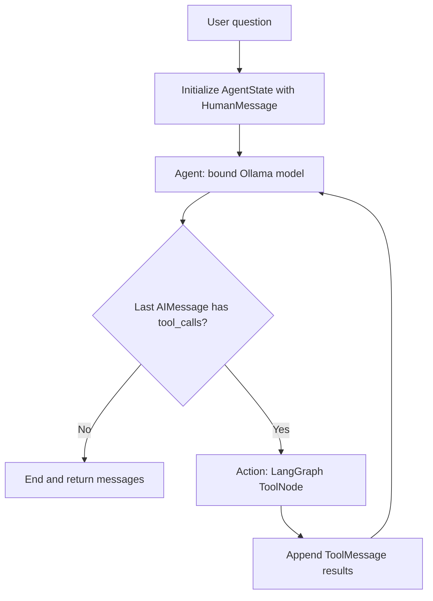
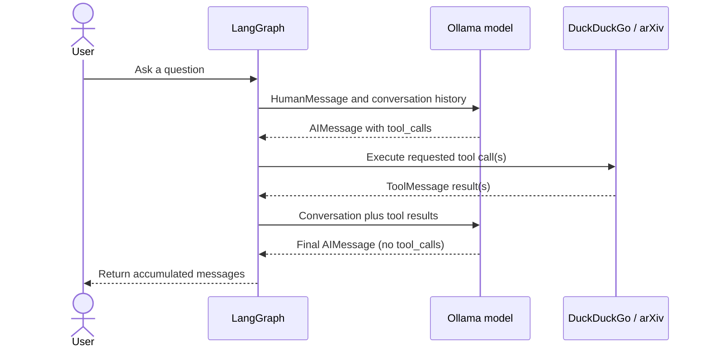

# Agentic RAG Research Assistant

This script uses a local Ollama chat model with two external research tools: DuckDuckGo search and arXiv search. LangGraph manages the conversation and decides whether to answer the user or run a tool requested by the model.

Despite the folder name, this script does not retrieve from a local document collection or build a vector index. It gathers context from web and arXiv searches when the model chooses to call those tools, then asks the model to respond using the conversation, including the tool results.

## Requirements

- Ollama installed and running locally.
- The `llama3.2:latest` model available to Ollama. For example: `ollama pull llama3.2`.
- The Python packages used by the script: `langchain-ollama`, `langchain-community`, `langgraph`, `duckduckgo-search`, and `arxiv`.
- Network access for DuckDuckGo and arXiv searches.

Run the script from this directory with:

```sh
python3 agentic_rag.py
```

## Main Components

### Conversation state

`AgentState` stores the conversation as a sequence of LangChain messages. Messages include the user's `HumanMessage`, model responses (`AIMessage`), and tool results (`ToolMessage`). The `operator.add` reducer tells LangGraph to append each node's new messages to the existing sequence.

### Tools

`tool_belt` contains `DuckDuckGoSearchRun` and `ArxivQueryRun`. The same tools are bound to the Ollama model and given to a LangGraph `ToolNode`:

- Binding tools tells the model which tools it may request and what their inputs look like.
- `ToolNode` looks up and executes the tool calls in the model's response, then adds tool result messages to the graph state.
- The model decides whether a tool is useful for a particular question. Merely binding a tool does not guarantee that it will be called.

### Model node

`call_model` sends the accumulated messages to the bound `ChatOllama` model and returns its response as a new message. The model is configured for `llama3.2:latest`, temperature `0.8`, and a maximum of `256` generated tokens (`num_predict`). Model validation is requested at initialization.

### Routing

After each model response, `should_continue` checks whether the last message is an `AIMessage` with any `tool_calls`:

- If tool calls are present, the graph routes to the action node.
- Otherwise, the graph ends and returns the accumulated messages.

The check uses `isinstance` because `AgentState` types messages as the general `BaseMessage`, while `tool_calls` is specific to AI messages.

## Flow



The tool cycle may repeat: after seeing tool output, the model can request another search, call another tool, or produce a final response.

## Message Sequence



The final graph result is a state dictionary whose `messages` value contains the full conversation, not just the final answer. The script currently iterates over and prints each message.

## Selecting a Query

There are two consecutive assignments to `inputs` near the bottom of `agentic_rag.py`. The second assignment replaces the first before `app.invoke(inputs)`, so the active query is currently:

> What is uTHCD defined in the research paper 2103.07676?

To run the RAG question instead, comment out or remove the second assignment. Keep only one active `inputs` assignment at a time.